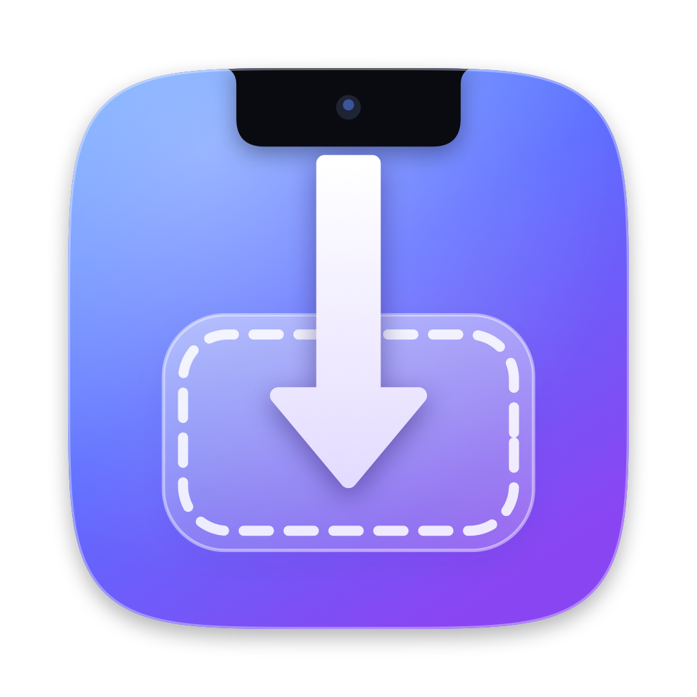
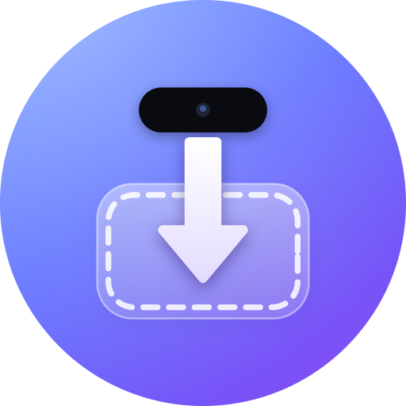

<p align="center">
  
  &nbsp;&nbsp;
  
</p>

<h1 align="center">NotchDrop</h1>

<p align="center">
  AirDrop-style sharing between a Mac and an Android phone.<br>
  Drag onto the notch to send to your phone; tap <b>Share → NotchDrop</b> on the phone to send to your Mac.<br>
  <b>No internet, no account, no cloud.</b> Works on the same Wi-Fi, or with the Mac on the phone's hotspot.
</p>

---

## Features

**Mac**
- Drag files, folders, links or text toward the notch. It expands into a drop zone with a marching, glowing outline that pulls particles inward while you hover. Drop to send.
- **Send hotkey.** Record any shortcut in *Settings → Shortcuts*. Pressing it sends the current selection:
  - If Finder is in front, it sends the selected files.
  - In any other app, it sends the selected text.
  - Otherwise it sends the clipboard.
- **Settings window**, in the style of System Settings. It opens when you launch the app, or from the menu bar with ⌘,. Panes:
  - *General:* launch at login, hide the menu-bar icon, sounds, trackpad haptics.
  - *Notch:* turn the notch drop zone on or off, open it on hover, and set the activation-zone width (up to 560 pt) and height (up to 200 pt) with sliders. Only drags inside that zone open the notch. A live dashed outline on screen shows the zone while you adjust it.
  - *Shortcuts:* the send hotkey and Accessibility status.
  - *Receiving:*
    - Choose the save folder. The default is `~/Downloads/From <phone>`.
    - Ask before accepting incoming items.
    - Auto-copy received text.
    - Auto-open received links.
  - *Devices:* rename this Mac, nickname the phone, pair or unpair.
- **Large transfers** show full details for a moment, then shrink to a slim strip around the notch: a direction arrow, the percentage and a thin progress bar. The notch opens again when the transfer finishes.
- **Received files** appear as thumbnails in the notch. Click one to reveal it in Finder.
- **Received text** is copied to the clipboard (optional), with an **Open Link** button.
- **Hidden menu-bar icon:** open NotchDrop again from Launchpad or Spotlight to get back to Settings.
- **Macs without a notch** get the same drop zone, which appears at the top center of the screen while you drag.

**Android**
- NotchDrop shows up in the share sheet for photos, videos, files, links and text.
- A Quick Settings tile sends the clipboard.
- An optional background receiver means the Mac can send at any time. Files go to `Downloads/From <Mac>`, and links and text arrive as notifications with **Copy** / **Open** actions.
- A custom design system in the style of Linkerly: stroke icons in tinted tiles, outlined cards, and spring-scaled, haptic press feedback on every control. Dialogs and the share sheet follow the predictive back gesture.
- A **Settings** screen, opened from the gear icon:
  - Names.
  - Background receiving.
  - Auto-copy text.
  - Auto-open links.
  - Battery optimization.
  - A System, Dark or Light theme.
  - Unpair.
- Pairing is a single QR scan.

**Both**
- **Rename anything.** Give your Mac or phone the name the other side sees, and give the paired device a local nickname.
- End-to-end encrypted with AES-256-GCM, using a key exchanged only through the QR code.
- Finds the other device automatically over Bonjour/NSD, and falls back to the last known IP addresses (for example, on a hotspot that blocks mDNS).

## Requirements

| | |
|---|---|
| Mac | macOS 14 or later, Swift 6 toolchain (Xcode or just the Command Line Tools) |
| Android | Android 10 or later (API 29) |
| Network | Same Wi-Fi network, **or** the Mac joined to the phone's hotspot |

## Build & run

### Mac

```sh
cd mac
./build.sh            # builds build/NotchDrop.app (ad-hoc signed)
./build.sh install    # also copies it to /Applications and launches it
```

On first launch macOS asks for **Local Network** access; allow it. The pairing window opens automatically. After that, launching the app opens Settings.

The send hotkey asks for permissions only the first time it needs them:
- **Accessibility**, to copy selected text in other apps.
- **Automation → Finder**, to read the Finder selection.

Without them, the hotkey sends the clipboard instead. Ad-hoc builds get a new code signature on every rebuild, so you may need to toggle NotchDrop off and on again in *Privacy & Security → Accessibility*.

Bundle IDs are `com.amurot.notchdrop` on both the Mac and Android.

> The app is ad-hoc signed, not notarized. If Gatekeeper complains after you copy it to another Mac, right-click → **Open** once.

### Android

Open `android/` in Android Studio and press Run. From the command line:

```sh
cd android
./gradlew :app:installDebug          # with a device connected over adb
# or
./gradlew :app:assembleRelease       # app/build/outputs/apk/release/app-release.apk
```

The release build is signed with the local debug key so you can sideload it directly. Use your own signing config before distributing it.

### Pair

1. On the Mac, open *Settings → Devices → Pair Phone…*, or use the menu-bar icon, to show a QR code.
2. On the phone, open NotchDrop → **Scan to pair**.
3. That's it. Optionally, tap **Allow** on the battery prompt so the phone can keep receiving in the background.

## How it works

Each device runs a small TCP server: the Mac on port 47820, the phone on 47821. Each advertises itself as `_notchdrop._tcp`. The QR code carries a one-time 256-bit key, the Mac's id and addresses. Every connection derives fresh per-direction keys with HKDF-SHA256 and encrypts every frame with AES-256-GCM. The full wire format is in [PROTOCOL.md](PROTOCOL.md).

```
mac/        SwiftPM app: Network.framework, CryptoKit, SwiftUI notch panel
android/    Kotlin + Jetpack Compose app, CameraX + ML Kit QR scanning
design/     Icon renderer (swift design/make-icons.swift) and previews
```

## Tests

```sh
cd mac && swift build && .build/debug/NotchDrop --selftest
cd android && ./gradlew :app:testDebugUnitTest   # includes Kotlin <-> Swift interop tests
```

The Android unit tests run the protocol against the real Mac binary in both directions when `mac/.build/debug/NotchDrop` exists, and skip those cases otherwise.

## Privacy & security

- Nothing leaves your local network. There are no servers, analytics or accounts.
- The pairing key is stored in `~/Library/Application Support/NotchDrop/peer.json` (mode 0600) on the Mac, and in app-private storage on Android, which is excluded from backups.
- Anyone who sees the QR code while it's on screen could pair with the Mac, so close the pairing window once you're done. Pairing a new phone replaces the old one.

## License

[MIT](LICENSE)
